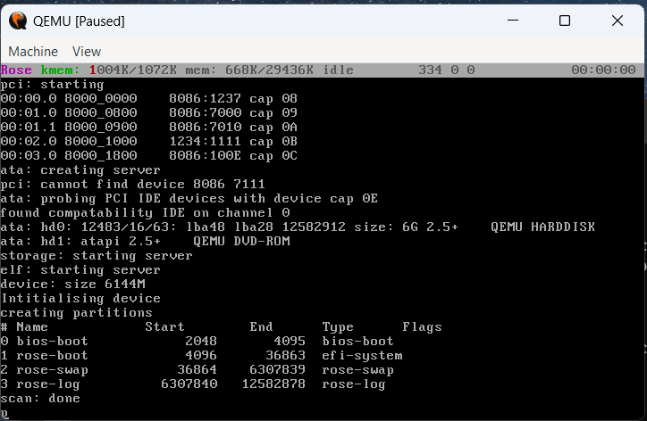
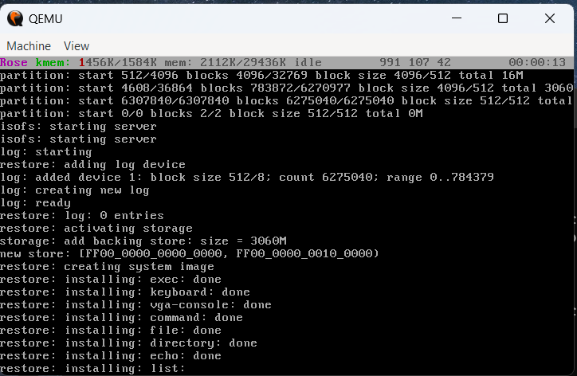
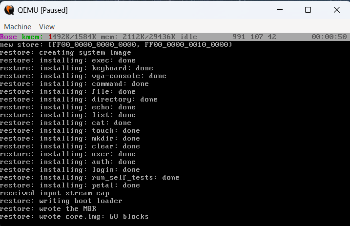
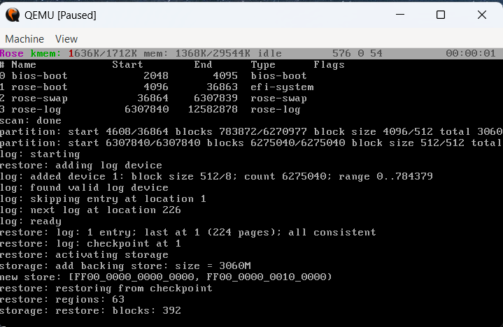
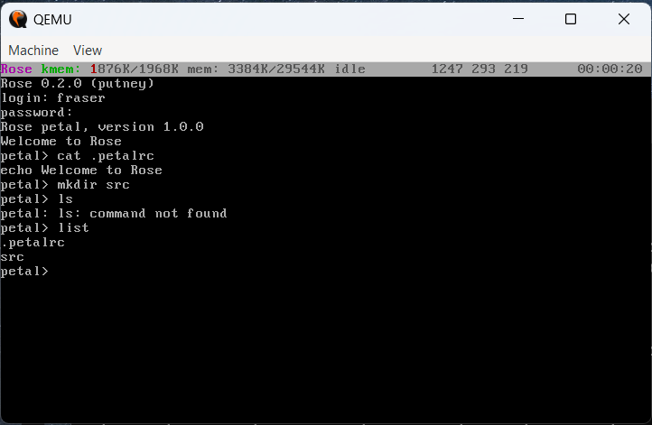
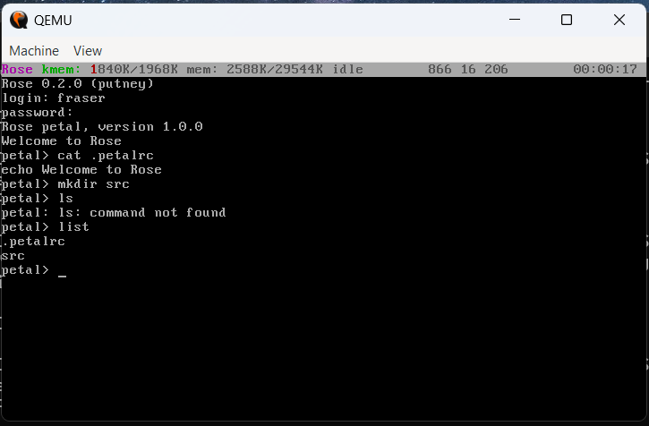

# rose
Persistent capability-based kernel

Website: [rose-os.org](https://rose-os.org)

## Requirements

Rose requires gcc 15 or later, and is known to build on Fedora 43.  The
run-time system is built from the GNAT sources, which `rts/copy-runtime.sh`
and `src/rts/create-sources.sh` copy from the installed compiler.
`make check-env` checks that everything the build needs is installed, and
`clean-build.sh` runs it first.

The build scripts assume Fedora's file layout.  Install
[Alire](https://alire.ada.dev) for the Ada toolchain (GNAT and gprbuild), and
these packages:

```
sudo dnf install make binutils python3 python3-pyyaml xorriso grub2-tools \
    grub2-tools-extra grub2-pc-modules mtools qemu-img
```

To boot the result you'll want `qemu-system-x86`.  To test under Bochs as
well, install bochs and run `sh bochs/run-bochs.sh`.

`clean-build.sh --book` also builds the book, which needs:

```
sudo dnf install asciidoctor rubygem-asciidoctor-pdf
gem install --user-install asciidoctor-epub3
```

## Build

Rose's interfaces are written in IDL and compiled to Ada by
[idle](https://github.com/blancolioni/idle), which isn't on Alire yet, so you
build it first.  idle needs [syn](https://github.com/blancolioni/syn) next to
it.

```
git clone https://github.com/blancolioni/rose.git
cd rose
git clone https://github.com/blancolioni/syn
git clone https://github.com/blancolioni/idle
(cd idle; alr build)
IDLE=$PWD/idle/bin/idle sh ./clean-build.sh
```

A bootable iso is created in the images directory.  `make test` boots it
under QEMU, runs the self tests, and checks the checkpoint log; it needs
`qemu-system-x86`.  `make hdd` creates a blank hard disk image there too, and
`make all` builds everything, including the book.

`clean-build.sh` runs `make -j` with a job for each processor (set `JOBS` to
change that), and so can you.  `make` builds the run-time systems if they are
missing, but doesn't rebuild them when their sources change: `make rts` does
that.

The drivers and the utilities are built with run-time checks: range, index and
overflow checks, and assertions.  `ROSE_CHECKS=unchecked make` builds them
without any, as they were built before, which makes them 1% to 6% smaller.

## Status

Rose boots, launches various services, and
reformats the hard drive.  It is therefore not what 
you would call ready for production.

## Screenshots



The first boot from the iso.  The bar at the top contains the name of the system, the amount of allocated kernel memory, the total available memory, the currently running process, the number of page faults, and the up time.  The PCI and ATA servers find the disk, and `scan` partitions it.



`restore` creates the system image on the new store, installing each driver and utility.



When it has finished, it writes the boot loader to the disk.



On the next boot, from the disk, the log is consistent and the system is restored from its checkpoint.



After login, a petal shell starts.  I typed a few commands, and received results.  `ls` isn't a command; `list` is.



The same screen after a power cycle.  Look at the up time: the machine has just started again, but the session, including the screen, is exactly as it was, because Rose is persistent.
